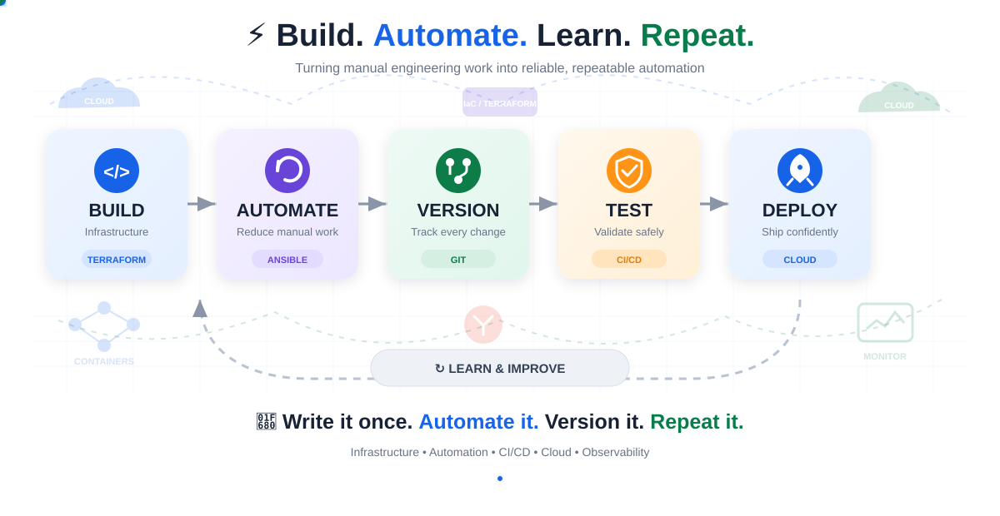
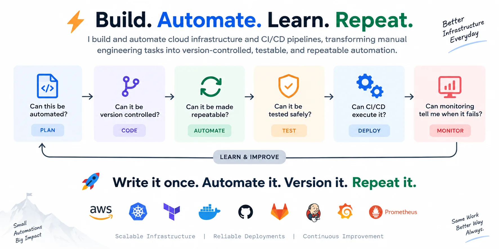
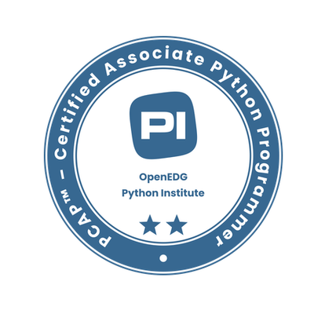
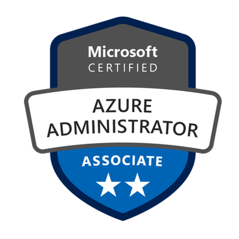
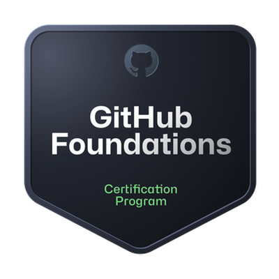
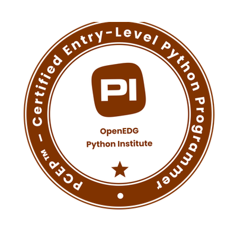
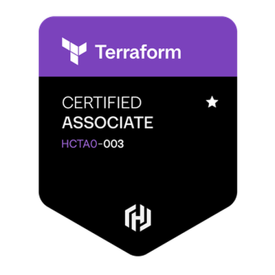
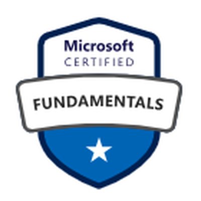

   

## 👨‍💻 About Me

I'm a **DevOps & Cloud Engineer with 4+ years of experience** grounded in production operations, incident troubleshooting, and system monitoring. My operations background shapes how I build infrastructure—focusing not just on shipping code, but on making platforms **resilient, observable, automated, and easy to operate.**

- ☁️ **Multi-Cloud & IaC:** Architecting and automating infrastructure across **AWS**, **Azure**, and **GCP** using **Terraform** and **Ansible**.
- 🔄 **CI/CD & GitOps:** Building automated delivery pipelines to eliminate manual toil and reduce deployment friction.
- 📊 **Reliability & Observability:** Designing proactive monitoring, alerting, and incident response workflows for production environments.
- 🚀 **Continuous Builder:** Currently building **WebBlog** and **Job Assistance** platforms while contributing to Cloud, Kubernetes, and Platform Engineering.

<!-- 

  

  

 -->

## 🧭 DevOps Toolkit

<!-- 

  
  
  
  
  
  
  
  
  
  
  
  
  
  
  

 -->

| Category | Technologies |
| :--- | :---: |
| **Cloud Platforms** |  &nbsp;&nbsp;  &nbsp;&nbsp;  |
| **Containers & Orchestration** |  &nbsp;&nbsp;  &nbsp;&nbsp; |
| **IaC & Configuration** |  &nbsp;&nbsp;  |
| **CI/CD & Version Control** |  &nbsp;&nbsp;  &nbsp;&nbsp;  &nbsp;&nbsp;  |
| **Observability & Scripting** |  &nbsp;&nbsp;  &nbsp;&nbsp;  &nbsp;&nbsp;  |

## 🚀 Featured Projects

| Project | Description | Tech Focus | Status |
| :--- | :--- | :--- | :---: |
| [**VM Module**](https://github.com/mukul-329/terraform-azurerm-virtual-machine-windows-linux) | Reusable Terraform module published on the registry for provisioning Windows & Linux VMs on Microsoft Azure. | `Terraform` `Azure` | 🟢 Completed |
| [**kubeadm-k8s**](https://github.com/mukul-329/kubeadm-k8s-cluster) | Automated Kubernetes cluster provisioning on AWS EC2 using Ansible, kubeadm, and Cilium CNI. | `AWS` `K8s` `Ansible` | 🟡 In Progress |
| [**WebBlog**](https://github.com/mukul-329/WebBlog) | 3-tier web application featuring containerization, automated CI/CD pipelines, and Kubernetes deployment. | `Docker` `K8s` `CI/CD` | 🟡 In Progress |
| [**OneApps**](https://github.com/mukul-329/OneApps) | Multi-service platform uniting media, commerce, travel, payments, and learning into a single ecosystem. | `Microservices` `Cloud` | 🟡 In Progress |
| [**DevBoard**](https://github.com/mukul-329/devboard) | Project and task management platform built for engineering team collaboration and progress tracking. | `Full-Stack` `DevOps` | 🟡 In Progress |

## 🎓 Certifications

  
  
  
  
  
  
  
  

## 📊 GitHub Stats:

 

---

### 🤝 Let’s build, automate, and scale together!

**Open to DevOps · SRE · Cloud · Platform Engineer roles**

